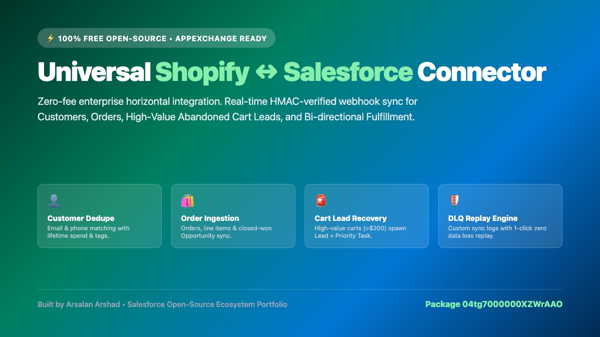
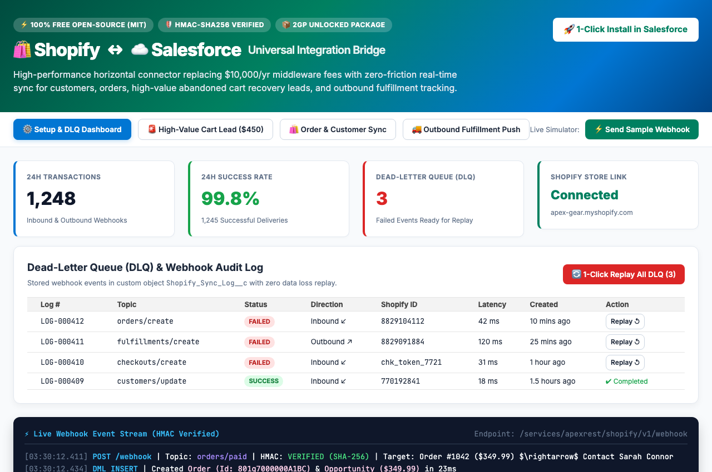
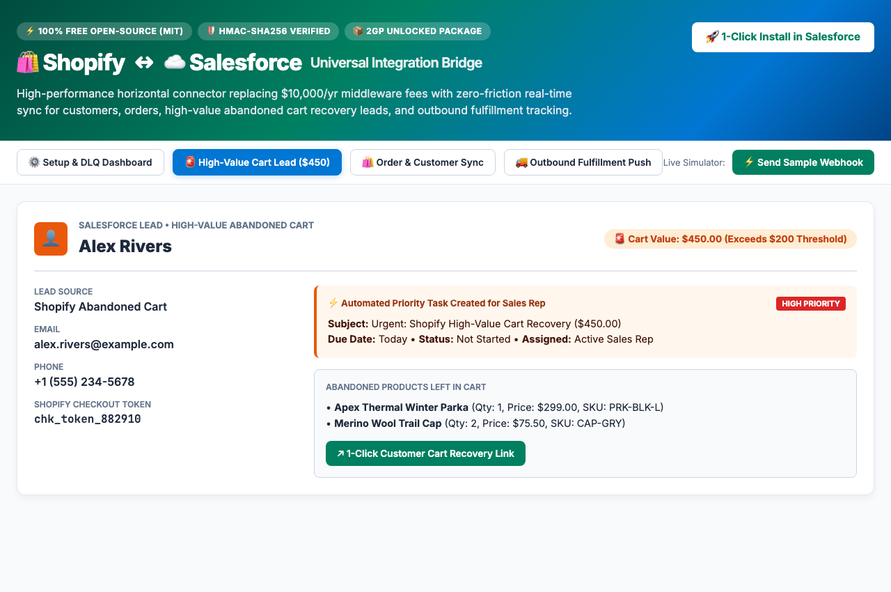
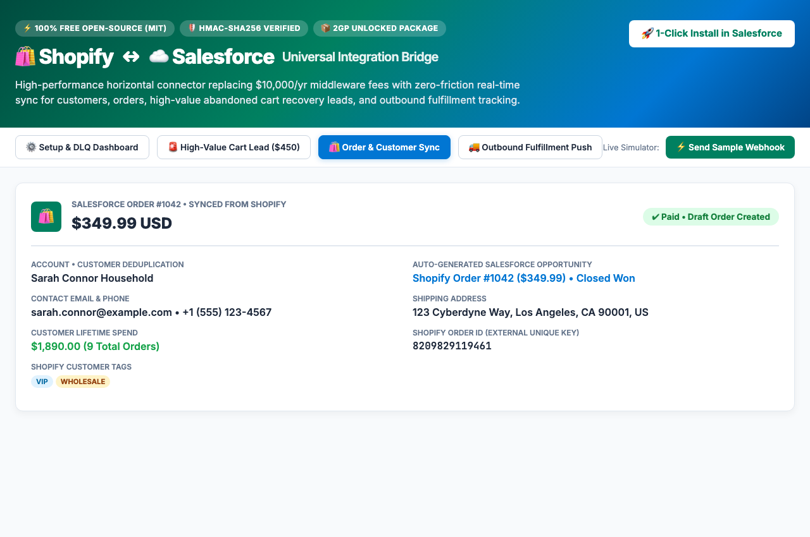
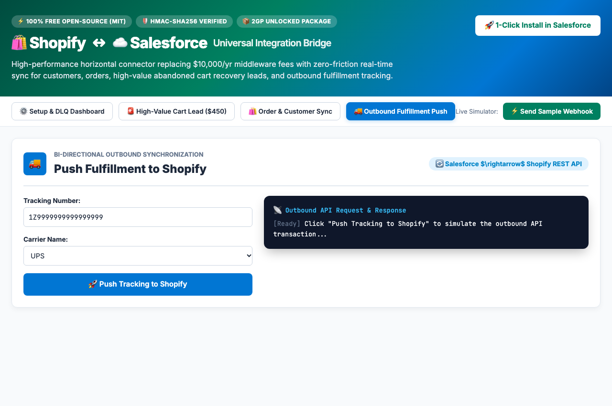
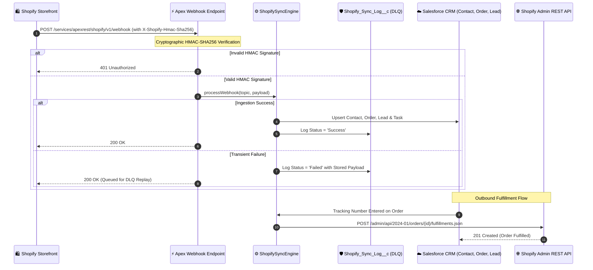

# Universal Shopify ↔ Salesforce Connector

<p align="center">
  
</p>

<p align="center">
  <a href="https://github.com/arsalan-arshad/shopify-salesforce-connector/blob/main/LICENSE"></a>
  <a href="https://login.salesforce.com/packaging/installPackage.apexp?p0=04tg7000000XZWrAAO"></a>
  <a href="https://github.com/arsalan-arshad/shopify-salesforce-connector/releases/tag/v0.1.0"></a>
  <a href=".github/RULESETS.md"></a>
  
</p>

> **100% Free Open-Source (MIT)** | Built for the E-Commerce &amp; Salesforce Trailblazer Community | Part of the **Salesforce Open-Source Ecosystem Portfolio** by **Arsalan Arshad**.

---

## 1. Overview &amp; Vision

A high-performance horizontal open-source integration bridge connecting Shopify storefronts with Salesforce CRM.

While existing enterprise tools (MuleSoft, Celigo) cost upwards of **$10,000/year** and basic middleware (Zapier, Make) charges per task execution, this connector provides a generous, zero-friction sync for core e-commerce data with **zero per-transaction fees**.

---

## 2. Killer Differentiators &amp; Features

- ⚡ **Zero Per-Task Pricing:** 100% open-source integration running on native Apex REST endpoints without middleware fees.
- 🛡️ **Cryptographic HMAC-SHA256 Verification:** Validates every incoming webhook against your Shopify shared secret using timing-safe comparison to prevent spoofing.
- 👤 **Customer &amp; Account Deduplication:** Real-time ingestion on `customers/create` &amp; `customers/update` with multi-tier matching (Shopify Customer ID $\rightarrow$ Email $\rightarrow$ Phone) and lifetime spend metrics.
- 🛍️ **Order &amp; Line Item Sync:** Ingests `orders/create`, `orders/updated`, and `orders/paid`, mapping line items to standard Pricebook entries, creating Orders, and syncing pipeline Opportunities.
- 🚨 **High-Value Abandoned Cart Lead Recovery:** High-value abandoned carts ($> \$200$) automatically spawn a Salesforce `Lead` with a cart recovery URL and an urgent `Task` for sales reps.
- 🚚 **Bi-directional Fulfillment Push:** Warehouse status updates in Salesforce automatically push tracking numbers and carriers back to the Shopify Admin REST API.
- 🔄 **Dead-Letter Queue (DLQ) &amp; Error Dashboard:** Custom object `Shopify_Sync_Log__c` tracks failed events with 1-click automated replay from stored payloads.

---

## 3. Direct 1-Click Package Installation

Install the Second-Generation (2GP) Unlocked Package directly into your Salesforce environment:

| Environment                        | Direct 1-Click Installation Link                                                                                        | Package Version ID   |
| :--------------------------------- | :---------------------------------------------------------------------------------------------------------------------- | :------------------- |
| **Production / Developer Edition** | [👉 Install in Production / Dev Org](https://login.salesforce.com/packaging/installPackage.apexp?p0=04tg7000000XZWrAAO) | `04tg7000000XZWrAAO` |
| **Sandbox Environment**            | [👉 Install in Sandbox Org](https://test.salesforce.com/packaging/installPackage.apexp?p0=04tg7000000XZWrAAO)           | `04tg7000000XZWrAAO` |
| **Salesforce CLI (`sf`)**          | `sf package install --package 04tg7000000XZWrAAO --target-org <ALIAS> --wait 20`                                        | `04tg7000000XZWrAAO` |

---

## 4. Visual Walkthrough &amp; UI Showcase

<table width="100%">
  <tr>
    <td width="50%">
      <h4 align="center"><b>1. Setup &amp; Dead-Letter Queue (DLQ) Dashboard</b></h4>
      
      <p align="center"><i>Live transaction metrics, credential management, and 1-click batch replay table.</i></p>
    </td>
    <td width="50%">
      <h4 align="center"><b>2. High-Value Abandoned Cart Lead ($450)</b></h4>
      
      <p align="center"><i>Automatic Lead and high-priority Task creation for carts exceeding the $200 threshold.</i></p>
    </td>
  </tr>
  <tr>
    <td width="50%">
      <h4 align="center"><b>3. Real-Time Order &amp; Customer Deduplication</b></h4>
      
      <p align="center"><i>Order record creation, household account linking, and Closed-Won Opportunity sync.</i></p>
    </td>
    <td width="50%">
      <h4 align="center"><b>4. Bi-directional Outbound Fulfillment Push</b></h4>
      
      <p align="center"><i>Outbound API call pushing carrier tracking numbers back to Shopify.</i></p>
    </td>
  </tr>
</table>

---

## 5. Interactive Standalone Simulator

Test the entire integration in your browser without needing live Shopify or Salesforce org credentials:

1. Open [`interactive_demo.html`](./interactive_demo.html) in any browser:
   ```bash
   open interactive_demo.html
   ```
2. Experience:
   - Live HMAC verification and webhook event streaming.
   - 1-Click Dead-Letter Queue (DLQ) recovery simulation.
   - High-value abandoned cart threshold routing.
   - Outbound fulfillment push to Shopify Admin REST API.

---

## 6. Architecture &amp; Data Flow



---

## 7. Setup &amp; Configuration Guide

### Step 1: Assign Permission Set

Assign the administrative permission set to your integration user:

```bash
sf org assign permset -n Shopify_Connector_Admin
```

### Step 2: Configure Store Settings in Salesforce

1. In Salesforce App Launcher, navigate to **Shopify Connector Configuration**.
2. Enter your:
   - **Shop Domain:** `your-store.myshopify.com`
   - **Webhook Shared Secret:** Provided in Shopify Admin $\rightarrow$ Notifications $\rightarrow$ Webhooks.
   - **Admin API Access Token:** Created in Shopify Partner Apps (`shpat_...`).
   - **Abandoned Cart Threshold:** Default `$200.00`.
3. Click **Save Settings**.
4. Copy your dedicated **Webhook URL**:
   ```
   https://<your-salesforce-domain>.my.salesforce.com/services/apexrest/shopify/v1/webhook
   ```

### Step 3: Register Webhooks in Shopify

In your Shopify Store Admin:

1. Go to **Settings** $\rightarrow$ **Notifications** $\rightarrow$ **Webhooks**.
2. Click **Create Webhook** and add the following subscriptions pointing to your Salesforce URL:
   - `orders/create` (JSON)
   - `orders/paid` (JSON)
   - `customers/create` (JSON)
   - `customers/update` (JSON)
   - `checkouts/create` (JSON)

---

## 8. Open-Source Governance, Branch Rulesets &amp; Releases

This repository strictly enforces open-source governance and release lifecycle standards:

- **Protected `main` Branch Ruleset:** Direct pushes to `main` are blocked. Merges require passing status checks (`CI - Pull Request Verification`) and pull request approvals. See [`.github/RULESETS.md`](.github/RULESETS.md).
- **Automated CI/CD Workflows:**
  - [`.github/workflows/ci.yml`](.github/workflows/ci.yml): Runs ESLint, Prettier, Node tests, and Salesforce deployment validation on PRs.
  - [`.github/workflows/cd.yml`](.github/workflows/cd.yml): Auto-deploys metadata to the packaging org on merge.
  - [`.github/workflows/release.yml`](.github/workflows/release.yml): Triggered on release tags (`v*`) to publish GitHub Releases and package assets.
- **Community Standards:** Includes [MIT License](LICENSE), [Code of Conduct](.github/CODE_OF_CONDUCT.md), [Security Policy](.github/SECURITY.md), [PR Template](.github/pull_request_template.md), and [Issue Templates](.github/ISSUE_TEMPLATE).

---

## 9. Standardized 4-Phase Delivery Framework

- [x] **Phase 1: Local Development &amp; Differentiators**
  - [x] Apex Webhook Ingestion REST endpoint with HMAC-SHA256 signature verification.
  - [x] Custom Setting `Shopify_Setting__c` for store domain, credentials, and thresholds.
  - [x] Core Sync Engine `ShopifySyncEngine.cls` (Customer dedupe, Order/Opportunity sync, Abandoned Cart Lead recovery).
  - [x] Outbound Fulfillment Service `ShopifyFulfillmentService.cls` for bi-directional sync.
  - [x] Dead-Letter Queue (DLQ) service `ShopifyDLQService.cls` with 1-click batch replay.
  - [x] Setup &amp; DLQ LWC `shopifyConnectorConfig` and Record Badge LWC `shopifySyncBadge`.
  - [x] 100% passing test suite across Apex and Node.js gateway.
- [x] **Phase 2: GitHub &amp; Open-Source Engineering**
  - [x] Git repository initialized with protected `main` branch ruleset.
  - [x] Automated GitHub Actions CI workflow (`ci.yml`) and CD workflow (`cd.yml`).
  - [x] Automated Release workflow (`release.yml`) for `v*` release tags.
  - [x] Exportable ruleset configuration [`.github/rulesets/main-ruleset.json`](.github/rulesets/main-ruleset.json) and documentation.
  - [x] Community health suite: MIT License, Code of Conduct, Security Policy, Issue/PR templates.
- [x] **Phase 3: 2GP Packaging &amp; Distribution**
  - [x] Second-Generation (2GP) Unlocked Package created: `ShopifySalesforceConnector` (`0Hog70000003qksCAA`).
  - [x] Package version built: `04tg7000000XZWrAAO` (`v0.1.0-1`).
  - [x] Direct 1-Click Install URLs generated for Production and Sandbox.
- [x] **Phase 4: Branding &amp; AppExchange Readiness**
  - [x] Complete 7-asset visual suite in `assets/` (App Icon 120x120, Hero Banner 16:9, 4 UI screenshots).
  - [x] Interactive simulation app [`interactive_demo.html`](./interactive_demo.html).
  - [x] Full AppExchange submission dossier [`APPEXCHANGE_LISTING.md`](./APPEXCHANGE_LISTING.md) with security review answers.
  - [x] Production-grade `README.md` with Trailblazer guide and architecture diagrams.

---

## 👤 Author &amp; Maintainer

Built with ❤️ for the global Salesforce &amp; Shopify Trailblazer community by **Arsalan Arshad**.
Distributed under the **MIT License**.
